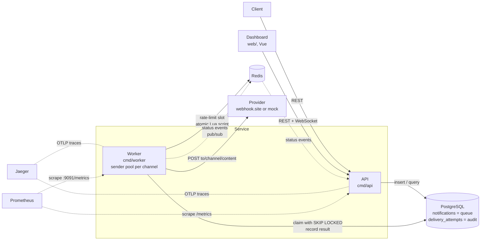

# Event-Driven Notification System

[](https://github.com/semihbceylan/event-driven-notification-system/actions/workflows/ci.yml)

A Go service that accepts SMS, email and push notifications over an HTTP API, queues them, and
delivers them through an external provider. It covers:

- **Throughput:** per-channel rate limiting (100/s) shared across all workers, and priority queues.
- **Reliable delivery:** idempotency, retries with backoff, and a circuit breaker that rides out
  provider outages without losing messages.
- **Visibility:** status tracking, correlation IDs from request to provider, a metrics endpoint,
  and Prometheus.

## Contents

- [Quick start](#quick-start)
- [Dashboard](#dashboard)
- [API examples](#api-examples)
- [Architecture](#architecture)
- [Design decisions](#design-decisions)
- [Configuration](#configuration)
- [Testing](#testing)
- [Project layout](#project-layout)
- [Limitations and next steps](#limitations-and-next-steps)
- [How I used AI tools](#how-i-used-ai-tools)

## Quick start

Requirements: Docker. Go 1.27+ is only needed to run the tests outside Docker.

```bash
docker compose up --build
```

| URL | What |
|---|---|
| http://localhost:3000 | **Dashboard**: send notifications, watch them live, simulate an outage |
| http://localhost:8080/docs | **Swagger UI**: try every endpoint in the browser |
| http://localhost:8080/openapi.yaml | OpenAPI 3.1 spec |
| http://localhost:8080/v1/metrics | Delivery metrics (JSON) |
| http://localhost:16686 | **Jaeger**: distributed traces, from API request to every delivery attempt |
| http://localhost:9090 | Prometheus |
| http://localhost:9091/breakers | Worker: circuit breaker state per channel |
| http://localhost:8090/admin/config | Mock provider: inject failures |

By default the worker sends to a **built-in mock provider**, so everything works offline. To add
**webhook.site**, as in the assessment, as a second provider you can switch to:

**One command:** `make webhook-url` creates a fresh URL that answers like the assessment's provider,
saves it as `WEBHOOK_SITE_URL` in `.env`, restarts the API and worker, and prints the page to watch
requests on. `make webhook-url SELECT=1` also switches delivery to it. Run it again whenever a URL runs
out, which is free.

Or by hand:

1. Create a URL that answers `202` with the JSON body below, either on webhook.site ("Edit" → status 202,
   content type `application/json`) or with their API:
   ```bash
   curl -s -X POST https://webhook.site/token -H 'Content-Type: application/json' \
     -d '{"default_status":202,"default_content_type":"application/json","default_content":"{\"messageId\":\"6f1c2a3e-0000-4000-8000-000000000000\",\"status\":\"accepted\",\"timestamp\":\"2026-11-23T12:00:00Z\"}"}' \
     | jq -r '"https://webhook.site/" + .uuid'
   ```
2. `cp .env.example .env` and set `WEBHOOK_SITE_URL=https://webhook.site/<uuid>`.
3. `docker compose up -d`, then pick **webhook.site** in the dashboard's *Delivery provider* selector
   (or `curl -X PUT localhost:8080/v1/provider -d '{"name":"webhook.site"}'`). Requests show up at
   `https://webhook.site/#!/<uuid>`.

> **A free webhook.site URL accepts only 50 requests in total, retries included, and expires after
> 7 days.** After that it answers `429 Request limit exceeded`. The system handles this correctly
> (it retries, and the circuit breaker pauses the channel), but nothing gets through. Use webhook.site
> to show the real integration with a few messages, and switch back to the mock for bursts and load tests.
> When a URL runs out, `make webhook-url` gets a new one; creating URLs is free.

## Dashboard

A Vue 3 + TypeScript app (`web/`), served by nginx at http://localhost:3000:

- **Metrics per channel** (polled every 2s): queue (due, waiting, sending), sent, failed, delivery and
  attempt success rates, p95 provider and delivery latency, and circuit breaker state.
- **Live feed** over WebSocket (`GET /v1/ws`): rows change from pending → processing → sent as the
  worker delivers them, with cancel and retry buttons.
- **Send form** with optional scheduling, and **Burst 100/1000** buttons that send a batch on the selected
  channel with mixed priorities, to show priority ordering and rate limiting.
- **`retrying` status** for a pending notification whose last attempt failed, so a temporary error is not
  mistaken for a failure.
- **Delivery provider selector**: shows which provider is actually receiving messages and switches
  between the configured ones (mock, webhook.site).
- **Simulate outage** (when the mock is active): switches the mock provider to 503s. The breaker opens, messages wait instead of
  failing, and they drain once you bring it back.

The worker and API publish every status change to Redis pub/sub, and each API replica forwards events to
its WebSocket clients. Events are best-effort; the dashboard reloads from the API after reconnecting.

For development: `cd web && npm install && npm run dev` (http://localhost:5173, proxying to the
compose stack).

## API examples

Full reference: [Swagger UI](http://localhost:8080/docs) or [`api/openapi.yaml`](api/openapi.yaml).

**Create a notification.** Repeat it with the same `Idempotency-Key` and you get the same
notification back (`200`); nothing is sent twice.

```bash
curl -s -X POST localhost:8080/v1/notifications \
  -H 'Content-Type: application/json' \
  -H 'Idempotency-Key: order-1234-shipped' \
  -H 'X-Correlation-ID: checkout-5678' \
  -d '{"recipient":"+905551234567","channel":"sms","content":"Your order has shipped!","priority":"high"}'
```
```json
{"id":"01a20918-8c4f-7e35-8592-30705854c105","channel":"sms","recipient":"+905551234567",
 "content":"Your order has shipped!","priority":"high","status":"pending","attempts":0,"max_attempts":5,
 "correlation_id":"checkout-5678","created_at":"2026-11-23T15:48:53.45Z", "...": "..."}
```

**Schedule one for later:** add `"scheduled_at":"2026-12-01T09:00:00Z"`.

**Invalid input** returns every problem at once:

```bash
curl -s -X POST localhost:8080/v1/notifications -H 'Content-Type: application/json' \
  -d '{"recipient":"abc","channel":"email","content":""}'
```
```json
{"error":{"code":"validation_failed","message":"request validation failed","details":[
  {"field":"recipient","message":"must be a valid email address"},
  {"field":"content","message":"is required"}]}}
```

**Batch of up to 1000:** all or nothing. Each item may have its own `idempotency_key`.

```bash
curl -s -X POST localhost:8080/v1/notifications/batch -H 'Content-Type: application/json' -d '{
  "notifications": [
    {"recipient":"+905551234567","channel":"sms","content":"Flash sale!","priority":"high"},
    {"recipient":"ali@example.com","channel":"email","content":"Flash sale!","idempotency_key":"sale-ali"},
    {"recipient":"device-token-abc","channel":"push","content":"Flash sale!","priority":"low"}
  ]}'
# → {"batch_id":"01a2...","total":3,"created":3,"replayed":0,"notifications":[...]}
```

**Status by ID or batch:**

```bash
curl -s localhost:8080/v1/notifications/<id>
curl -s localhost:8080/v1/batches/<batch_id> | jq '{total, status_counts}'
# → {"total":1000,"status_counts":{"sent":985,"pending":12,"failed":3}}
```

**List with filters and cursor pagination:**

```bash
curl -s 'localhost:8080/v1/notifications?status=failed&channel=sms&from=2026-11-23T00:00:00Z&limit=50'
# → {"data":[...],"next_cursor":"MTc2Mzkx..."}   pass it as &cursor=... for the next page
```

**Templates:** store content with `{{variable}}` placeholders once, then send by name.

```bash
curl -s -X PUT localhost:8080/v1/templates/order_shipped -H 'Content-Type: application/json' \
  -d '{"channel":"sms","content":"Merhaba {{name}}, siparişiniz {{order_id}} kargoya verildi!"}'
# → 201 {"name":"order_shipped","variables":["name","order_id"],...}

curl -s -X POST localhost:8080/v1/notifications -H 'Content-Type: application/json' \
  -d '{"recipient":"+905551234567","channel":"sms","template":"order_shipped","variables":{"name":"Ayşe","order_id":"TR-1234"}}'
# → {"content":"Merhaba Ayşe, siparişiniz TR-1234 kargoya verildi!","template":"order_shipped",...}
```

A missing variable is a validation error (`"variables": "missing values for: order_id"`). Templates also
work per item in batches; each template is loaded once per request.

**Cancel** (only while `pending`) **or retry** (only once `failed`):

```bash
curl -s -X POST localhost:8080/v1/notifications/<id>/cancel
curl -s -X POST localhost:8080/v1/notifications/<id>/retry
```

**Metrics:**

```bash
curl -s 'localhost:8080/v1/metrics?window=5m' | jq .channels.sms
```
```json
{"queue":{"due":0,"waiting":1,"processing":0},
 "sent":300,"failed":0,"success_rate":1,"attempts":328,"attempt_success_rate":0.9146,"sent_per_second_avg":1,
 "provider_latency_ms":{"p50":31,"p95":33,"p99":34},
 "delivery_latency_ms":{"p50":1398.25,"p95":3209.48,"p99":3682.35}}
```

## Architecture



- **API** (`cmd/api`): validates and stores notifications, and serves status, listing, metrics and docs.
  It runs the database migrations on startup.
- **Worker** (`cmd/worker`): for each channel, a pool of senders loops **circuit breaker check → claim
  → rate-limit slot → send → record result**. It also runs a reaper for crashed workers. Both API and
  worker are stateless and can run as many replicas as needed.
- **PostgreSQL** is the source of truth *and* the queue (see below). **Redis** holds the shared rate limiter.

Lifecycle of a notification:

```
pending ──claim──▶ processing ──2xx──────────────────────────▶ sent
 ▲  │                  │
 │  └─cancel─▶ cancelled├─ temporary error, attempts left ─────▶ pending (next_attempt_at = now + backoff)
 │                     ├─ permanent error, or no attempts left ─▶ failed ──retry endpoint──▶ pending
 └── reaper ◀──────────┘  lock expired (worker crashed)
```

## Design decisions

### PostgreSQL as the queue

The `notifications` table is both the record of every notification and the work queue. Workers claim
rows with `SELECT … FOR UPDATE SKIP LOCKED`, so many workers can pull from it at once without taking
the same row. This gives several features with little code:

- **Priority:** `ORDER BY priority, next_attempt_at` (high first, then oldest), served by a partial index.
- **Scheduled sends and retry backoff:** a row is only picked up when `next_attempt_at <= now()`.
- **Cancellation:** `UPDATE … WHERE status = 'pending'` is atomic, so cancel and claim cannot both win.
- **No dual-write problem:** saving a notification and enqueueing it are the same insert, so a crash
  can never leave a message saved but not queued (or the reverse).

The required throughput is well within what this handles: 100 msg/s × 3 channels is at most ~300
claims per second. At much higher volumes I would move the queue to Kafka or RabbitMQ behind the same
`Queue` interface, keeping Postgres for status.

### Delivery and retries

| Provider result | Retry? | Why |
|---|---|---|
| 2xx | – | Sent. A 2xx with an unexpected body still counts as sent; retrying would send it twice. |
| 408, 429, 5xx, timeout, connection error | Yes | Temporary; the provider may recover. |
| Other 4xx | No | The request itself is wrong (bad number, rejected content). It would fail again. |

- **Backoff:** exponential with jitter. The delay doubles per attempt (2s, 4s, 8s … capped at 10 min) and
  a random point in its upper half is used, so messages that failed together do not all retry at the
  same moment. A `Retry-After` header from the provider wins if it asks for longer.
- **Attempts:** `MAX_ATTEMPTS` (default 5), then `failed`. `POST /v1/notifications/{id}/retry` re-queues
  a failed notification. Every try is stored in `delivery_attempts` with its status code, error and timing.
- **Crash safety:** a claim sets `locked_until`. If a worker dies mid-send, the reaper puts the row back
  after the lock expires. `attempts` doubles as a fencing token: a worker whose lock expired cannot
  overwrite the result of the worker that took over.
- **Delivery guarantee: at-least-once.** If a worker crashes after the provider accepted a message but
  before saving the result, the message is sent again. The notification ID goes out as an
  `Idempotency-Key` header so a provider that supports it can drop the duplicate.
- **Graceful shutdown:** on SIGTERM, senders stop claiming, and in-flight sends finish and are recorded.

### Circuit breaker

Retries alone handle short glitches, but not outages. With 5 attempts and backoff starting at 2s, a
message uses up its attempts in about 30 seconds, so a one-minute provider outage would mark every
queued message as failed.

Each channel therefore has a circuit breaker (`internal/breaker`):

- **Open:** after 5 consecutive temporary failures, or immediately when the provider sends
  `Retry-After`. While open, the channel **stops claiming**, so queued messages keep all their attempts.
- **Half-open:** after a cooldown, exactly one probe is sent. Success closes the breaker; failure doubles
  the cooldown (5s → 10s → 20s … up to 1 min).
- **Not counted:** permanent 4xx errors. They mean the provider is up and rejected one message.

Measured with a simulated 60-second outage and 300 queued SMS: **13 provider calls** during the outage
(the probes) instead of ~1500. Then **all 300 were sent, none failed** (287 on the first try). The cost
is that sending resumes at the next probe rather than the instant the provider recovers, bounded by
`BREAKER_MAX_COOLDOWN`.

The breaker is per worker process. With several replicas, each one learns about an outage on its own,
which costs a few extra attempts but needs no coordination.

### Rate limiting

A sliding-window log in Redis (`internal/ratelimit`), shared by all worker replicas: at most 100 sends per
channel in **any** rolling second, not just per calendar second. A per-second counter would allow 100 at
0.99s and another 100 at 1.01s. The check is one Lua script, so it is atomic across workers, and it uses
Redis's clock, so workers need not agree on time.

Measured with 1000 SMS: the batch drained at ~100/s, and `redis-cli MONITOR` showed never more than 100
slots granted in any one-second span. Measured where requests leave the worker, a few more can appear in
a rolling second during bursts, because the delay between getting a slot and sending varies by a few
milliseconds. If a provider enforces its limit strictly, configure headroom, e.g. `RATE_LIMIT_PER_SECOND=90`.

If Redis is unreachable, workers stop sending, and return claimed notifications to the queue, rather
than sending without a limit.

### Idempotency

- **Single create:** the `Idempotency-Key` header. **Batch:** an `idempotency_key` per item.
- **Enforcement:** a unique partial index plus `INSERT … ON CONFLICT DO NOTHING`. When two identical
  requests race, Postgres makes the second wait for the first, so exactly one row is created. A test
  fires 20 concurrent duplicates and checks this.
- **Same key, different content:** rejected with `409`. Silently returning the old notification would
  hide a client bug.

### Validation

| Channel | Recipient | Content limit |
|---|---|---|
| SMS | E.164 phone number (`+905551234567`) | 1600 characters (10 × 160-character segments) |
| Email | A bare address (no `Name <…>`) | 20,000 characters |
| Push | A device token, ≤512 characters, no spaces | 1000 characters (APNs/FCM payloads are capped at 4 KB) |

Limits count characters, not bytes, so Turkish text is not penalised. Unknown JSON fields are rejected,
so a typo like `reciptient` fails loudly. Errors list every invalid field at once.

### Templates

- **Rendered when the notification is created,** and the rendered text is stored. Editing or deleting a
  template never changes a notification that is already queued, and the audit trail shows exactly what
  was sent. `template_name` records where it came from.
- **Plain `{{name}}` substitution rather than Go's `text/template`.** Templates are written by API clients,
  and `text/template` has loops and function calls, which are unnecessary here and a risk. Substituted
  values are not parsed again, so a variable containing `{{...}}` is inserted as literal text.
- **Errors surface early:** malformed placeholders and over-long content are rejected when the template is
  saved, and missing variables when a notification is created. The rendered text then goes through the
  channel's normal length checks.

### Provider selection

Deliveries go to one of the providers configured on the server (`PROVIDERS`, e.g. `mock` and
`webhook.site`). The active one is stored in Redis, so every worker replica follows a switch within a
second. Switching resets the circuit breakers, because the old provider's failures say nothing about
the new one.

**The API switches by name only and never accepts or returns a URL.** If anyone could set a URL, one
request would redirect every notification (phone numbers, emails, message content) to a server of
their choosing, and a webhook.site URL is itself a secret, since anyone who has it can read what is
sent there. In production this endpoint would also be admin-only.

### Database design

- **UUIDv7 primary keys:** they start with a timestamp, so inserts append to the end of the index
  instead of landing at random places in it.
- **Partial indexes** for every hot query, so they only cover the rows that matter: the claim query
  (`WHERE status='pending'`), stuck-job recovery, the metrics windows and idempotency keys. Finished
  rows, which is most of the table over time, stay out of them.
- **Keyset pagination** on `(created_at, id)` instead of `OFFSET`: page 1000 is as fast as page 1, and
  rows are not skipped or repeated when new ones arrive between requests.
- **Versioned migrations** (`migrations/`, goose), embedded in the binary and applied on startup.
  Applied migrations are never edited; changes come as new ones (e.g. `00002` added
  `delivery_attempts.started_at`).

### Observability

- **Structured JSON logs** (`log/slog`) with a **correlation ID**. It is taken from `X-Correlation-ID` or
  generated, returned in the response, stored on the notification, logged by the worker on every attempt,
  and sent to the provider. One ID traces a message end to end.
- **`GET /v1/metrics`:** queue depth (due, waiting, processing), sent and failed counts, success rates,
  and provider and delivery latency percentiles per channel. It is computed in Postgres, so it is
  correct with any number of workers.
- **Prometheus** (`:8080/metrics`, `:9091/metrics`): `http_requests_total` (labelled by route pattern,
  never raw paths, to bound cardinality), `notifications_queue_depth`, `notifications_processed_total`,
  `provider_request_duration_seconds`, `notification_delivery_latency_seconds`, `rate_limit_wait_seconds`
  and `circuit_breaker_state`.
- **Distributed tracing** (OpenTelemetry → Jaeger). The API and the worker never call each other, and a
  message may be sent minutes later or retried several times. So the API stores the request's W3C
  `traceparent` on the notification row, and the worker continues that trace for every delivery attempt.
  One trace then shows the API request and its SQL, then each attempt with its rate-limit check, provider
  call (which also receives a `traceparent` header) and database update, with retries in between.
  Measured: a batch sent while the provider failed half its requests produced one trace of 106 spans
  over 18.6s, covering 7 attempts (3 sent, 4 retries).
  - **Sampling:** only incoming API requests start traces. Idle queue polls, the reaper and Prometheus
    scrapes would otherwise flood Jaeger, so the worker only continues existing traces. Health checks,
    `/metrics` and the WebSocket are not traced.
  - **Off by default** outside docker compose: tracing turns on when `OTEL_EXPORTER_OTLP_ENDPOINT` is set.
  - **Logs:** each log line carries `trace_id` next to `correlation_id`.
- **Health:** `/healthz` (process up) and `/readyz` (Postgres and Redis reachable) on both the API and
  the worker. An open circuit breaker does not make the worker unready: it is waiting on purpose, and
  restarting it would not help.

## Configuration

All settings are environment variables; docker compose passes the main ones through.

| Variable | Default | Meaning |
|---|---|---|
| `PROVIDERS` | `mock=…` (compose: mock + webhook.site) | Selectable providers, `name=url,name=url`; empty URLs are skipped |
| `DEFAULT_PROVIDER` | `mock` | Provider used until one is selected |
| `WEBHOOK_SITE_URL` | unset | Compose only: adds your webhook.site URL to `PROVIDERS` |
| `PROVIDER_TIMEOUT` | `5s` | Per provider request |
| `RATE_LIMIT_PER_SECOND` | `100` | Per channel, across all workers |
| `WORKERS_PER_CHANNEL` | `10` | Concurrent senders per channel per worker process |
| `MAX_ATTEMPTS` | `5` | Delivery attempts before `failed` |
| `RETRY_BASE_DELAY` / `RETRY_MAX_DELAY` | `2s` / `10m` | Backoff range |
| `BREAKER_THRESHOLD` | `5` | Consecutive temporary failures that open the breaker |
| `BREAKER_COOLDOWN` / `BREAKER_MAX_COOLDOWN` | `5s` / `1m` | First and maximum open period |
| `LOCK_TIMEOUT` | `2m` | How long a claim is reserved before the reaper may requeue it |
| `POLL_INTERVAL` | `200ms` | Idle sender sleep when the queue is empty |
| `LOG_LEVEL` | `info` | `debug`, `info`, `warn`, `error` |
| `OTEL_EXPORTER_OTLP_ENDPOINT` | unset (compose: Jaeger) | Where to send traces; tracing is off when unset |

## Testing

```bash
make test   # go test -race ./... (integration tests start Postgres and Redis with testcontainers; needs Docker)
cd web && npm test   # dashboard unit tests (vitest)
make smoke           # end-to-end checks against the running stack (scripts/smoke.sh)
```

**CI** (GitHub Actions, `.github/workflows/ci.yml`) runs on every push and pull request:
gofmt, `go vet` and golangci-lint; Go tests with the race detector, including the testcontainers
integration tests; dashboard tests and type-checked build; then the whole stack with
`docker compose up` and `scripts/smoke.sh`, which checks delivery, idempotency, validation, and that a
simulated provider outage pauses delivery without failing any message.

| Layer | What is covered |
|---|---|
| Unit | Validation rules, backoff, circuit breaker states, provider error classification, worker decisions (sent/retry/fail, breaker stops claims, shutdown releases work), HTTP handlers |
| Integration (real Postgres and Redis) | Idempotency under 20 concurrent duplicates; 10 workers never claim the same row; priority order; fencing against stale workers; reaper; pagination and filters; metrics queries; limiter never exceeds its limit across 8 concurrent callers |
| Contract | Every route is in `openapi.yaml` and vice versa; every `$ref` resolves |
| WebSocket | Real connection through the middleware: events are delivered, filtered by batch, and clients are cleaned up on disconnect; slow clients are dropped |
| Dashboard | Merging live events: out-of-order events are ignored, errors are kept while retrying and cleared once sent |

**Try the failure handling yourself** with the stack running and the **mock** provider selected (the default):

```bash
# 1. Take the provider down: every request gets 503
curl -X PUT localhost:8090/admin/config -d '{"failure_rate":1,"failure_status":503}'

# 2. Queue a burst
jq -nc '{notifications:[range(300)|{recipient:"+90555\(1000000+.)",channel:"sms",content:"Sale \(.)"}]}' \
  | curl -s -X POST localhost:8080/v1/notifications/batch -H 'Content-Type: application/json' -d @- | jq -r .batch_id

# 3. Watch: the breaker opens and the batch waits as pending, with nothing failed
curl -s localhost:9091/breakers; curl -s localhost:8080/v1/batches/<batch_id> | jq .status_counts

# 4. Bring it back: everything is delivered
curl -X PUT localhost:8090/admin/config -d '{"failure_rate":0}'
```

`{"failure_rate":1,"failure_status":429,"retry_after":30}` simulates rate limiting by the provider.

## Project layout

```
api/                 OpenAPI spec (embedded and served at /openapi.yaml)
cmd/api              HTTP API
cmd/worker           Delivery worker
cmd/mockprovider     Offline stand-in for webhook.site with failure injection
internal/notification  Domain model, validation, Postgres store, queue and stats queries
internal/worker      Sender loop, retry decisions, backoff
internal/breaker     Circuit breaker
internal/ratelimit   Redis sliding-window limiter
internal/provider    Provider HTTP client and error classification
internal/httpapi     Handlers, middleware, routing, docs
internal/metrics     Prometheus metrics
internal/logging     slog setup, correlation ID context
internal/events      Status events: Redis pub/sub and WebSocket fan-out
internal/tracing     OpenTelemetry setup, sampling, trace context propagation through the database
web/                 Vue dashboard (Vite, TypeScript, nginx)
migrations/          Versioned SQL migrations (goose)
deploy/prometheus/   Prometheus scrape config
```

## Limitations and next steps

- **Strict priority can starve low priority** if high-priority traffic never stops. Aging (raising a
  message's priority the longer it waits) would fix this.
- **At-least-once delivery:** a crash at the wrong moment can send a duplicate (see above).
- **Circuit breakers are per process**, not shared through Redis.
- **Workers poll** the queue (200 ms when idle). Postgres `LISTEN/NOTIFY` could wake them instantly.
- **No authentication or multi-tenancy**: out of scope for the assessment. In production I would add API
  keys per client and scope idempotency keys per client.
- **One provider URL for all channels.** Real systems would have a provider per channel, possibly
  with failover.
- **Old notifications are never archived.** At millions per day, partitioning `notifications` by month
  would keep the hot table small.

## How I used AI tools

<!-- DRAFT: rewrite this section in your own words before submitting. -->

I built this with an AI coding assistant and reviewed its output before accepting it. Cases where
review or measurement caught something:

- **Rate limiter.** An end-to-end run showed up to 109 sends in a rolling second against a limit of 100.
  The assistant's first explanation ("a measurement artifact") was wrong, and so was its second. I had
  it measure at the source: capturing Redis's grant log with `MONITOR` showed a real bug, timestamps
  rounded to milliseconds. After fixing that, the same capture showed the limiter itself never exceeds 100.
  The remaining excess comes from the delay between getting a slot and sending, which is now documented
  instead of hidden.
- **Retry design.** When I asked whether the project "does its job correctly", a review turned up that
  a provider outage longer than ~30 seconds would fail every queued message. That led to the circuit
  breaker, which was then verified with a simulated 60-second outage.
- **Specs and tests.** A test that compares the router to `openapi.yaml` caught a YAML syntax error in the
  generated spec. Tests with a tight tolerance replaced loose ones that would have hidden the limiter bug.
